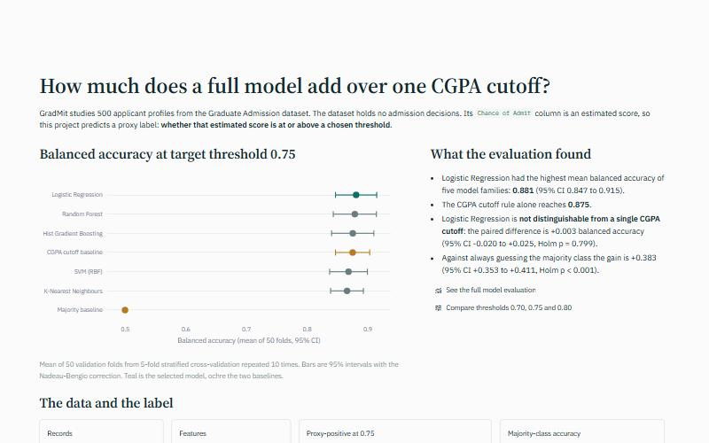
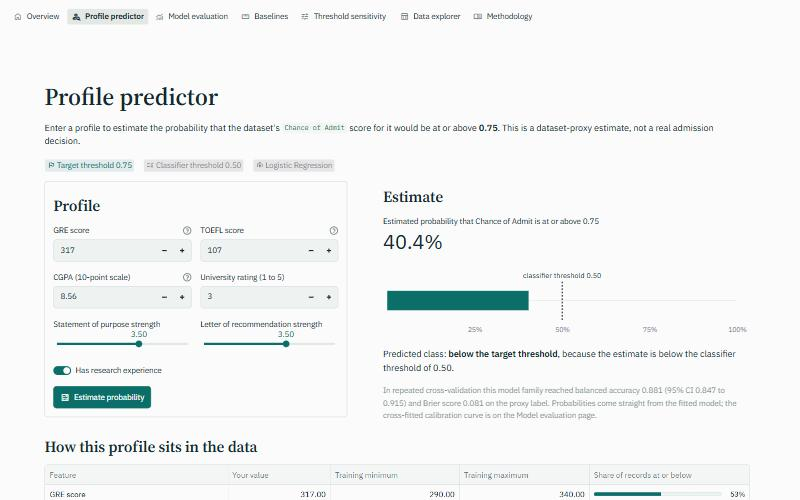
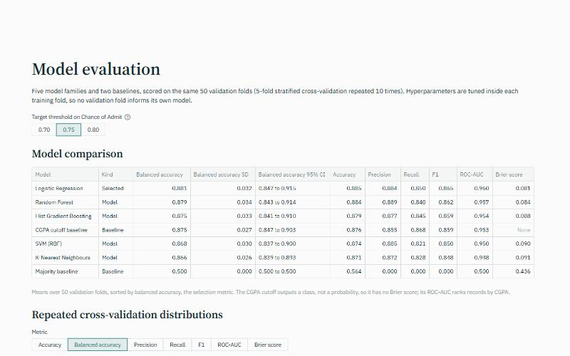
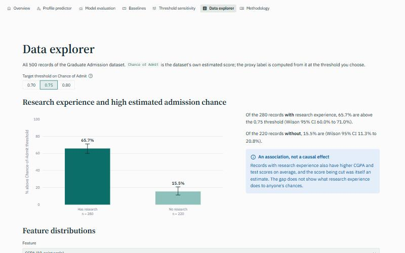

# GradMit

A reproducible machine-learning study and Streamlit app built on the Graduate Admission dataset.

**GradMit does not predict real admission.** The dataset contains no observed admission decisions;
its `Chance of Admit` column is itself an estimated score. The model predicts a proxy label:

> `High_Admission_Chance`: whether the dataset's estimated Chance of Admit is at or above a selected
> threshold.

Two thresholds are kept separate:

| Threshold | Values | Role |
|---|---|---|
| Target threshold | 0.70, 0.75 (default), 0.80 | Defines the proxy label from `Chance of Admit` |
| Classifier decision threshold | 0.50 | Turns a predicted probability into a predicted class |

Student: Saanvi Grover · Institute: JIIT Noida · Domain: Data Analytics and Machine Learning

## Headline result

At the default target threshold of 0.75, Logistic Regression had the highest mean balanced accuracy
of five model families, 0.881 (95% CI 0.847 to 0.915) over 50 validation folds. A single
`CGPA >= cutoff` rule reaches 0.875 on the same folds. The paired difference between them is +0.003
balanced accuracy (95% CI -0.020 to +0.025, Holm p = 0.7993): **the full model is not
distinguishable from one CGPA cutoff**. It is clearly better than always guessing the majority
class (+0.383, 95% CI +0.353 to +0.411, Holm p = 0.0002).

An earlier version of this project reported 91.2% accuracy from a single 75/25 split and described
it as admission prediction. That figure is retired: it came from one split, had no baseline, and
treated the proxy label as a real outcome.

## Screenshots

| Overview | Profile predictor |
|---|---|
|  |  |

| Model evaluation | Data explorer |
|---|---|
|  |  |

## Dataset

Mohan S. Acharya, Asfia Armaan and Aneeta S. Antony, *A Comparison of Regression Models for
Prediction of Graduate Admissions*, IEEE ICCIDS 2019, distributed on Kaggle as "Graduate
Admission 2". `data/Admission_Predict.csv` holds 500 records with no missing values and no duplicate
rows: GRE score, TOEFL score, university rating, statement-of-purpose strength,
recommendation-letter strength, CGPA, a research-experience flag, and `Chance of Admit`.

## Install and run

Python 3.13 with the pinned dependencies:

```bash
pip install -r requirements.txt
streamlit run app.py
```

The app loads the committed pipeline in `artifacts/` and the committed results in `outputs/`. It
never trains or evaluates a model at start-up.

App pages, grouped in the top navigation: Problem statement (the landing page) and Overview;
Results (Model evaluation, Baselines, Threshold sensitivity); Explore (Profile predictor, Data
explorer); About (Methodology).

## Reproduce the evaluation

```bash
pip install -r requirements-dev.txt
python scripts/evaluate_models.py     # nested repeated CV at 0.70 / 0.75 / 0.80, writes outputs/
python scripts/train_final_model.py   # tunes and saves the selected model, writes artifacts/
python scripts/verify_outputs.py      # checks committed files against a fresh run (fast mode)
```

`scripts/verify_outputs.py --full` also re-runs the full nested cross-validation for every model.

### Protocol

- **Outer loop:** `RepeatedStratifiedKFold(n_splits=5, n_repeats=10, random_state=42)`, 50
  validation folds shared by every model and both baselines.
- **Inner loop:** hyperparameters chosen by 5-fold stratified grid search on the training fold only.
  Scalers sit inside each pipeline, so nothing is fitted on validation rows.
- **Selection:** highest mean balanced accuracy over the outer validation folds at the default
  threshold. No single test split is used.
- **Intervals:** 95% intervals on fold means use the Nadeau-Bengio corrected resampled t-interval,
  because repeated folds share training data.
- **Paired tests:** each record's out-of-fold probabilities are averaged over the ten repeats to give
  one cross-fitted prediction per record and model. Differences in balanced accuracy get a paired
  row-level bootstrap interval and a paired permutation p-value (10,000 resamples each),
  Holm-corrected across the two baseline comparisons. An improvement is called supported only when
  the interval excludes zero and the corrected p-value is below 0.05.

## Results

Every number below comes from a committed file in `outputs/`; a test fails if they drift.

### Model comparison at target threshold 0.75

Source: `outputs/model_comparison.csv` (fold-level scores in `outputs/repeated_cv_fold_scores.csv`).

| Model | Balanced accuracy | SD | 95% CI | Accuracy | Precision | Recall | F1 | ROC-AUC | Brier |
|---|---:|---:|---|---:|---:|---:|---:|---:|---:|
| Logistic Regression | 0.881 | 0.032 | 0.847 to 0.915 | 0.885 | 0.884 | 0.850 | 0.865 | 0.960 | 0.081 |
| Random Forest | 0.879 | 0.034 | 0.843 to 0.914 | 0.884 | 0.889 | 0.840 | 0.862 | 0.957 | 0.084 |
| Hist Gradient Boosting | 0.875 | 0.033 | 0.841 to 0.910 | 0.879 | 0.877 | 0.845 | 0.859 | 0.954 | 0.088 |
| CGPA cutoff baseline | 0.875 | 0.027 | 0.847 to 0.903 | 0.876 | 0.855 | 0.868 | 0.859 | 0.953 | n/a |
| SVM (RBF) | 0.868 | 0.030 | 0.837 to 0.900 | 0.874 | 0.885 | 0.821 | 0.850 | 0.950 | 0.090 |
| K-Nearest Neighbours | 0.866 | 0.026 | 0.839 to 0.893 | 0.871 | 0.872 | 0.828 | 0.848 | 0.948 | 0.091 |
| Majority baseline | 0.500 | 0.000 | 0.500 to 0.500 | 0.564 | 0.000 | 0.000 | 0.000 | 0.500 | 0.436 |

Means over 50 validation folds. The CGPA cutoff outputs a class, not a probability, so it has no
Brier score; its ROC-AUC ranks records by CGPA. The gaps between model families are far smaller than
their fold-to-fold spread, so their order is not meaningful.

### Baselines

- **Majority baseline:** `DummyClassifier(strategy="most_frequent")`. At 0.75 the proxy-positive
  class is 218/500 = 43.6% and the proxy-negative class 282/500 = 56.4%, so the rule scores 56.4%
  accuracy and 50% balanced accuracy.
- **CGPA cutoff baseline:** predict proxy-positive when `CGPA >= cutoff`. In each fold the cutoff is
  chosen on the training rows to maximise training balanced accuracy, frozen, and applied to the
  validation rows. It is never chosen with all 500 labels.

### Paired comparisons of Logistic Regression with each baseline

Source: `outputs/paired_tests.csv`. Difference in balanced accuracy, model minus baseline.

| Target threshold | Compared with | Difference | 95% CI | p | Holm p | Improvement supported |
|---|---|---:|---|---:|---:|---|
| 0.70 | Majority baseline | +0.361 | +0.328 to +0.392 | 0.0001 | 0.0002 | Yes |
| 0.70 | CGPA cutoff baseline | +0.028 | +0.001 to +0.053 | 0.0380 | 0.0380 | Yes |
| 0.75 | Majority baseline | +0.383 | +0.353 to +0.411 | 0.0001 | 0.0002 | Yes |
| 0.75 | CGPA cutoff baseline | +0.003 | -0.020 to +0.025 | 0.7993 | 0.7993 | No |
| 0.80 | Majority baseline | +0.411 | +0.382 to +0.438 | 0.0001 | 0.0002 | Yes |
| 0.80 | CGPA cutoff baseline | -0.010 | -0.033 to +0.013 | 0.4214 | 0.4214 | No |

The model beats the majority rule at every threshold. Against the CGPA cutoff, an improvement is
supported only at 0.70, and narrowly: the lower end of that interval is +0.001.

### Threshold sensitivity

Source: `outputs/threshold_sensitivity.csv`. BA is balanced accuracy; the model is Logistic
Regression, the family selected at 0.75 and reused at the other thresholds.

| Target threshold | Positive | Positive share | Majority accuracy | Majority BA | CGPA cutoff BA | Model BA (95% CI) | CGPA F1 | Model F1 | CGPA ROC-AUC | Model ROC-AUC | Model minus CGPA (95% CI) | Holm p |
|---|---:|---:|---:|---:|---:|---|---:|---:|---:|---:|---|---:|
| 0.70 | 300 | 60.0% | 60.0% | 0.500 | 0.820 | 0.862 (0.832 to 0.892) | 0.837 | 0.887 | 0.920 | 0.943 | +0.028 (+0.001 to +0.053) | 0.0380 |
| 0.75 | 218 | 43.6% | 56.4% | 0.500 | 0.875 | 0.881 (0.847 to 0.915) | 0.859 | 0.865 | 0.953 | 0.960 | +0.003 (-0.020 to +0.025) | 0.7993 |
| 0.80 | 155 | 31.0% | 69.0% | 0.500 | 0.918 | 0.910 (0.877 to 0.943) | 0.877 | 0.879 | 0.973 | 0.978 | -0.010 (-0.033 to +0.013) | 0.4214 |

### Research experience and high estimated admission chance

Source: `outputs/research_association.csv`. Each row is `P(proxy-positive | Research status)`: the
share of that research group whose Chance of Admit is at or above the threshold, with a Wilson 95%
interval.

| Target threshold | Group | n | Above threshold | Rate | Wilson 95% CI |
|---|---|---:|---:|---:|---|
| 0.70 | Has research | 280 | 225 | 80.4% | 75.3% to 84.6% |
| 0.70 | No research | 220 | 75 | 34.1% | 28.1% to 40.6% |
| 0.75 | Has research | 280 | 184 | 65.7% | 60.0% to 71.0% |
| 0.75 | No research | 220 | 34 | 15.5% | 11.3% to 20.8% |
| 0.80 | Has research | 280 | 144 | 51.4% | 45.6% to 57.2% |
| 0.80 | No research | 220 | 11 | 5.0% | 2.8% to 8.7% |

This is an association, not a causal effect. Records with research experience also have higher CGPA
and test scores, and the score being cut is itself an estimate. The chart, with its y-axis
"% above Chance-of-Admit threshold", is on the Data explorer page and in notebook 01. An earlier
version of the project reversed this conditional probability; `tests/test_statistics.py` now checks
the direction.

## Limitations

- **No real outcomes.** Nothing here is validated against an admission decision.
- **The label is a cut on a continuous estimate.** Records near the cut are labelled almost
  arbitrarily. Notebook 04 shows that most errors are such records.
- **Small, narrow sample.** 500 records from one source. The predictor warns when an input lies
  outside the training range.
- **Associations only.** Features are strongly correlated with one another; no coefficient, chart or
  estimate supports a causal reading or advice about applying.
- **Selection optimism.** Choosing the best of five families on the same outer folds makes its score
  slightly optimistic. The paired tests compare it with the baselines on equal terms.
- **Uncorrected calibration.** Probabilities are the fitted model's own. The cross-fitted calibration
  curve and Brier score are reported so they can be judged.

## Notebooks

All four are committed with executed outputs and import the project modules instead of copying
modelling code.

| Notebook | Covers |
|---|---|
| `notebooks/01_data_audit_and_eda.ipynb` | Provenance, schema, missing values and duplicates, target construction, class balance, distributions, Research association, correlation caveats |
| `notebooks/02_model_comparison_and_baselines.ipynb` | Both baselines, model pipelines, repeated stratified CV, fold-level distributions, selection rationale |
| `notebooks/03_threshold_sensitivity_and_statistics.ipynb` | Threshold sensitivity, paired bootstrap and permutation tests, Holm correction, ranking stability |
| `notebooks/04_error_analysis_and_final_model.ipynb` | Cross-fitted confusion matrix, calibration, ROC and precision-recall, error slices, most confident errors, final training, artifact parity |

Re-execute them from the repository root:

```bash
jupyter nbconvert --to notebook --execute --inplace notebooks/*.ipynb
python scripts/check_notebooks.py
```

## Tests and CI

```bash
pytest -q
ruff check .
```

The tests cover the dataset schema and row count, target counts at each threshold, disjoint and
stratified folds, training-only CGPA cutoff selection, majority-baseline behaviour, deterministic
repeated-CV output, the direction of the Research conditional probability, artifact loading and
parity with a fresh fit, the metrics JSON schema, predictor input validation, a smoke test of every
app page, and that the numbers in this README match the committed outputs.

`.github/workflows/ci.yml` installs the pinned dependencies, lints, checks that every notebook
parses and is executed, runs `scripts/verify_outputs.py` in fast mode, imports the Streamlit app and
runs the tests. Fast mode recomputes both baselines on all folds, the fold summaries, the paired
tests and the Research table exactly, re-runs the selected model on the first repeat, and checks the
saved pipeline against a fresh fit.

## Repository structure

```text
app.py                      Streamlit entry point (navigation only)
app_pages/                  One script per app page
assets/                     Logo and icon used by the app header and browser tab
gradmit/
├── data.py                 Loading, schema, proxy-target construction, input validation
├── evaluation.py           CV protocol, metrics, fold summaries and intervals
├── baselines.py            Majority and CGPA cutoff baselines
├── modelling.py            Pipelines, grids, nested CV, final training
├── statistics.py           Wilson intervals, paired bootstrap/permutation, Holm
├── reporting.py            Builds and loads the files in outputs/
├── verification.py         Reproducibility checks used by CI and tests
├── charts.py               Plotly figures for the app
└── ui.py                   Cached loaders and shared widgets for the app
scripts/
├── evaluate_models.py      Full evaluation, writes outputs/
├── train_final_model.py    Trains the deployed pipeline, writes artifacts/
├── verify_outputs.py       Checks committed files against a fresh run
└── check_notebooks.py      Checks notebooks parse and are executed
artifacts/                  gradmit_pipeline.joblib, model_metadata.json
outputs/                    Fold scores, comparison, sensitivity, paired tests, Research table,
                            cross-fitted predictions, model_evaluation.json
notebooks/                  Four executed notebooks
tests/                      pytest suite
data/Admission_Predict.csv  The dataset
```

## Author

Saanvi Grover (AI and Data Analytics)
